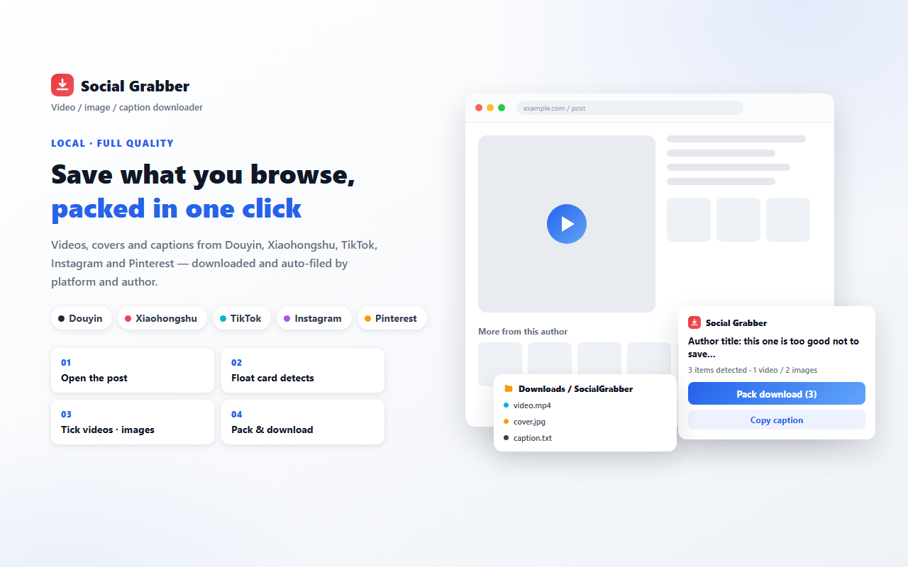

# Social Grabber — save the social media post you are viewing

**Social Grabber** is a free Chrome / Edge extension that puts a small card in the corner of
[Douyin](https://www.douyin.com), [Xiaohongshu (RedNote)](https://www.xiaohongshu.com),
[TikTok](https://www.tiktok.com), [Instagram](https://www.instagram.com) and
[Pinterest](https://www.pinterest.com). One click saves the post you are already looking at —
video, cover image, every image in a carousel, and the caption text — into one folder on your own
computer. Nothing is uploaded and there is no account or server behind it.



*Illustration, not a screenshot — the card is shown with the English interface.*

**Install:** [Chrome Web Store](https://chromewebstore.google.com/detail/apcgdmmomohncjmajfbaoklmdflgboho)
· **Extension ID:** `apcgdmmomohncjmajfbaoklmdflgboho` · **Website:** https://socialgrabberapp.github.io/SocialGrabber/

> **About this repository:** it hosts the project's **website, privacy policy and guides** (the
> files served by GitHub Pages). It does **not** contain the extension's source code — the
> extension itself is distributed only through the browser stores. Open an
> [issue](https://github.com/socialgrabberapp/SocialGrabber/issues) for support, bug reports or
> questions about the site.

## At a glance

| | |
|---|---|
| Cost | Free, no sign-up, no account system |
| Where the work happens | Entirely in your browser: detection, parsing and downloading |
| Uploads | None. The only outbound requests are the plain `GET`s for the exact files you chose to save |
| Permissions | `downloads`, `storage`, `downloads.open` — plus host permissions for image/video CDN hosts, **not** for the platforms' main domains |
| Keyboard shortcut | `Ctrl+Shift+S` (`Command+Shift+S` on Mac) packs the current post |
| UI language | Simplified Chinese and English, follows the page language |
| Minimum Chrome | 111 |

## What one click gives you

For a video post:

```
Downloads/SocialGrabber/Douyin/<author>/<publish-date>_<title>_<post-id>/
├── <title>.mp4              the source address the page itself loaded
├── <title>_cover.jpeg       the video's own cover image
└── <title>_caption.txt      caption, author, source URL, media links, AI-rewrite prompt
```

For an image-set (carousel) post, each image is saved as `<title>_image1.jpeg`,
`<title>_image2.jpeg`, … For a Xiaohongshu note you get the note text and its images; for TikTok
the video, cover and caption; for Instagram and Pinterest the video, carousel images and text.

File name suffixes follow the interface language, so a Chinese interface writes `_封面`, `_配图1`,
`_文案.txt` into the same layout.

Three details that are deliberate:

- **The post id is part of the folder name.** Two posts by the same author that happen to share a
  title would otherwise resolve to one folder and overwrite each other.
- **A `.txt` always travels with the media.** It lists every direct link it saved with a plain-language
  label above each one (which file is the watermark-free video, which is the cover), plus a footer with
  the capture time. Links that failed to download stay listed so you can rescue them by hand.
- **The `.txt` ends with a ready-to-send AI rewrite prompt.** It is a plain text template shipped in
  the file — the extension contains no AI and calls no model. It also states, in the file, that the
  signed links will expire and that the uploaded video file is what a model should actually be given.

## Batch on a profile or a collection

On an author profile (e.g. `douyin.com/user/…`, `tiktok.com/@handle`,
`xiaohongshu.com/user/profile/…`) and on a collection page (`…/playlist/<id>`, Instagram
`/guides/…`), the card lists the posts **that page has already loaded while you were browsing**.
Tick the ones you want and pack only those; posts you already saved are badged so they are not
fetched twice. Entries whose author or collection identity cannot be resolved are skipped rather
than listed — a short list beats a wrong one.

**What it deliberately does not do:** it never paginates, never crawls an account, and never fetches
posts you have not scrolled to. It does not download comments, and it does not record live streams.
Account-level scraping is exactly what platform anti-abuse systems target, so this stays out of scope.

## Guides

- [Xiaohongshu video downloader — Chrome extension guide (EN)](guides/xiaohongshu-video-downloader-chrome-extension.html)
- [TikTok downloader — Chrome extension guide, including why link-based downloaders 403 (EN)](guides/tiktok-video-downloader-chrome-extension.html)
- [抖音视频下载：Chrome 扩展怎么保存无水印作品（中文）](guides/douyin-video-downloader-chrome-extension.html)

## Privacy

Read [privacy-policy.html](privacy-policy.html). Short version: no server, no analytics, no account,
nothing you browse is collected or transmitted; page content stays local and the only files fetched
are the ones you chose to save.

## Trademark note

Social Grabber is not affiliated with Douyin, Xiaohongshu, TikTok, Instagram or Pinterest; all product
names and trademarks belong to their respective owners. Save only content you are entitled to keep —
copyright remains with the original author or platform, and you are responsible for complying with
their terms of service and your local laws.

## Contact

`socialgrabber.app@gmail.com` · [Issues](https://github.com/socialgrabberapp/SocialGrabber/issues)
